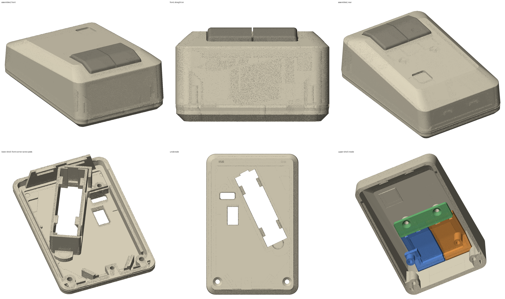

# Macintosh Mouse (M0100) — Logitech M185 conversion

A 3D-printed shell that turns a **Logitech M185** wireless mouse into a replica of the
original **Apple Macintosh mouse (M0100)**. The M185's guts (PCB, sensor, switches,
battery contacts) are reused; the printed parts replace the stock case. Unlike the
one-button original, this one has **two buttons**, and with no cable the front is smooth.

It is a sibling of the [Lisa mouse conversion](https://github.com/wottle/lisa-mouse-logitech-m185)
and reuses that project's M185 mounting, power slider and battery door.



<!-- TODO(author): replace the render above with a photo of the finished mouse. -->

> **Status: work in progress.** The shells have been printed and test-fitted and both
> buttons click, but the design is still being revised. See [Known issues](#known-issues).

## What you need

| Item | Notes |
|------|-------|
| **Genuine** Logitech M185 wireless mouse | Donor for the electronics. Knock-offs sold as the M185 have a different PCB and will not fit. |
| 3D printer + PLA | See [docs/PRINTING.md](docs/PRINTING.md). |
| Small Phillips screwdriver | For the M185's own screws. |
| 1 × AA battery | Alkaline AA. |
| PTFE mouse slides (optional) | The underside is flat with no feet. |
| M3 screws | See the table below. |

### Screws

All holes use the same sizes as the Lisa mouse: 2.7 mm pilot, 3.2–3.3 mm clearance.

| Use | Screw | Qty |
|-----|-------|:---:|
| PCB, rear boss | M3×4 flat head | 1 |
| PCB, front standoff in the scroll-wheel cutout (add a washer for more grip) | M3×6 | 1 |
| Button retainer | M3×6 countersunk | 2 |
| Button strikers (head down, used for adjustment) | M3×8 countersunk | 2 |
| Case, front corners, from underneath | M3×8 countersunk | 2 |

## Printed parts

STL files are in [`models/`](models/). Dimensions are the bounding box in the model's
design orientation (X × Y × Z, mm). All parts except the logo plate are in assembled
position in one common frame (X right, Y toward the buttons, Z up, underside at Z = 0).

| File | Qty | Size (mm) | Purpose |
|------|:---:|-----------|---------|
| `lower_shell.stl` | 1 | 61.3 × 93.9 × 18.1 | Bottom shell. M0100 outline with the M185 mounting inside: PCB seats, rear screw boss, front standoff, sensor window, power-switch slot, diagonal AA bay. Flat underside with a 45° bevel. |
| `upper_shell.stl` | 1 | 61.4 × 94.3 × 27.8 | Top shell. M0100 form with the cable/screw tab removed, vertical side walls, a 1.4 mm recess for a logo plate, and bosses inside for the case screws and the button retainer. |
| `button_left.stl` | 1 | 23.7 × 34.5 × 17.2 | Left button, with a post for its striker screw. |
| `button_right.stl` | 1 | 20.5 × 34.5 × 17.2 | Right button, with a post for its striker screw. |
| `button_retainer.stl` | 1 | 40.8 × 12.1 × 2.4 | Plate that holds both buttons' hinge bar in the top shell. |
| `logo_plate_blank.stl` | 1 | 9.9 × 9.9 × 1.4 | Blank insert for the logo recess. Add your own logo and print it separately. |
| `on_off_button.stl` | 1 | 12.0 × 7.2 × 6.0 | Power switch slider. Unchanged from the Lisa mouse. |
| `battery_cover_1.stl` | 1 | 14.7 × 53.1 × 8.9 | Battery door, main plate. Unchanged from the Lisa mouse. |
| `battery_cover_2.stl` | 1 | 7.5 × 11.8 × 6.2 | Battery door, latch piece. Unchanged from the Lisa mouse. |

Part previews are in [`images/`](images/).

## Build it

1. **Print** the parts — [docs/PRINTING.md](docs/PRINTING.md)
2. **Assemble** — [docs/ASSEMBLY.md](docs/ASSEMBLY.md)

## How it differs from the original M0100

- Two buttons: the original button is split down the middle with a 0.8 mm slot.
- No cable, so the tab at the front that held the cable and the case screws is gone.
  The case screws moved to the front corners, driven from underneath. The rear still
  hooks in with the original two tabs.
- The upper shell's side walls are vertical (the original leans in 1.75°), so it can be
  printed lying on its side.
- The underside is flat, without the ball ring and feet.
- The left striker sits outboard of the left button, under the shell's shoulder, because
  the M185's left switch is about 3 mm outside the button opening.

## Known issues

- Button fit in the shell opening is the original 0.3 mm per side and may need a light
  sanding.
- The two rear latch tabs on the upper shell are small overhangs in most print
  orientations.
- Striker screws must be tuned with the case screws tight; see the assembly guide.
- The switch positions come from caliper measurements on one M185 board
  (`210-002552 REV003`). Other board revisions have not been checked.

## Repository layout

```
models/     Print-ready STLs (one per part)
docs/       Printing and assembly instructions
images/     Part previews
scripts/    build_models.py — regenerates models/ and images/preview.png from source/
source/     Input meshes for the scripts (see source/README.md)
```

## Rebuilding the models

```
pip install -r scripts/requirements.txt
python3 scripts/build_models.py
```

The script rebuilds every part from the meshes in `source/`, then checks that no two
printed parts overlap, at rest and with each button pressed. The dimensions that are most
likely to need changing are constants at the top of `scripts/build_top.py` (switch
positions, striker length, hinge clearances) and `scripts/smooth_front.py` (case screw
and PCB standoff positions, logo recess depth).

## Credits

This project is a remix of existing models. Thank you to their creators:

- **Apple Macintosh mouse M0100** — the outer shell and button are based on this model.
  <!-- TODO(author): add the model's link, creator and licence. -->
- **Apple Lisa mouse** — <https://www.thingiverse.com/thing:6547918>
- **Amiga Mouse (Logitech M185)** — the inner mounting for the M185 electronics
  originally comes from this model:
  <https://www.printables.com/model/1137373-amiga-mouse-logitech-m185>

The M185 mounting, power slider and battery door are taken from the
[Lisa mouse conversion](https://github.com/wottle/lisa-mouse-logitech-m185).

<!-- TODO(author): confirm the licence below is compatible with every original model's licence; adjust LICENSE if not. -->

## License

[CC BY-NC-SA 4.0](LICENSE) — share and adapt with attribution, non-commercially, under the same license.
