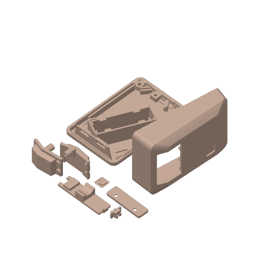
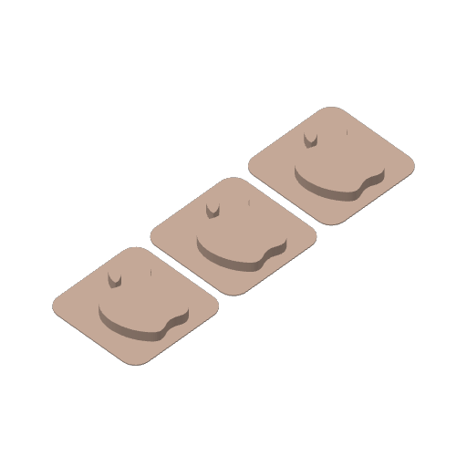

# Printing

A ready-to-slice project is in [`print/`](../print/):

- `MacMouse_BambuStudio_A1.3mf` — Bambu Studio 2.7, Bambu Lab A1, 0.4 mm nozzle.

It has every part oriented and the supports set up, so the simplest route is to open it,
pick your filament and print. If you use another slicer or printer, copy the orientations
and settings below.

**Which upper shell:** this page is for FDM, with `models/fdm/upper_shell.stl` (straightened sides,
printed on its side) and everything in `models/common/`. On a resin printer use
`models/resin/upper_shell.stl` instead: it keeps the original M0100's leaning side walls. Orient and
support resin parts as your resin slicer suggests.

| Plate 1 — all parts | Plate 2 — logo badges |
|---|---|
|  |  |

## Settings used

| Setting | Value |
|---------|-------|
| Printer / nozzle | Bambu Lab A1, 0.4 mm |
| Profile | 0.20mm Standard |
| Filament | PLA (PolyTerra PLA) |
| Bed | Textured PEI plate |
| Walls / infill | 2 walls, 15% grid |
| Supports | Off globally; turned on per part as listed below |

## Orientation and supports

| Part | Orientation | Supports |
|------|-------------|----------|
| `lower_shell.stl` | As modelled, flat underside on the bed. | None. The underside is flat with a 3 mm × 45° bevel, and the case-screw recesses end in a 45° cone. |
| `upper_shell.stl` | On its side, one side wall on the bed. | Tree supports, painted manually (threshold 30°), only where needed. On its side the top stands square to the bed, so it has no stepped layer lines. |
| `button_left.stl`, `button_right.stl` | Standing on the flat face that faces the other button. | Tree supports, automatic. |
| `button_retainer.stl` | Flat. | None. |
| `on_off_button.stl`, `battery_cover_1.stl`, `battery_cover_2.stl` | As modelled. | None. |
| Logo badge | Flat, show face up, 0.12 mm layers with top-surface ironing (plate 2). | None. |

The upper shell's two side faces are planed dead flat (0.3 mm off each side of the
original form), so it sits fully on the bed and the top prints square.

The project also contains the logo badge used on the mouse in the photos. The repository's
`models/common/logo_plate_blank.stl` is a blank of the same size for making your own.

## Fit notes

- The buttons have 0.3 mm clearance per side in the shell opening and a 0.8 mm slot
  between them. Sand the cap edges lightly if they rub.
- The hinge bar on each button runs in sockets with 0.15 mm clearance, with the retainer
  plate 0.07 mm underneath. If a button does not swing freely, sand the bar lightly or
  back the retainer screws off a little.
- The two rear tabs on the upper shell sit in slots with 0.25 mm clearance above them. If
  the rear of the case is loose or will not go together, change `LATCH_GAP` in
  `scripts/smooth_front.py` and rebuild.
- The logo recess is 10.1 × 10.1 mm and 1.4 mm deep; the blank is 9.9 × 9.9 × 1.4 mm.
